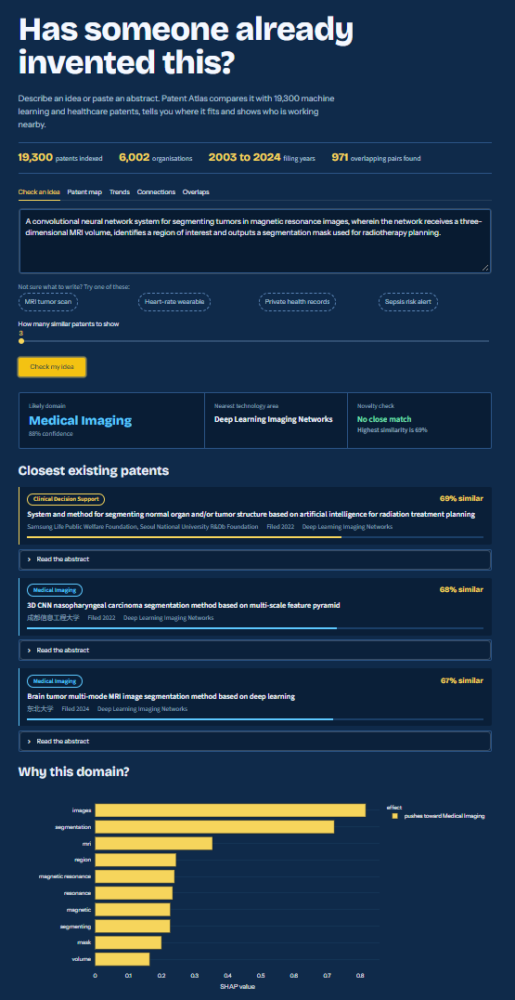
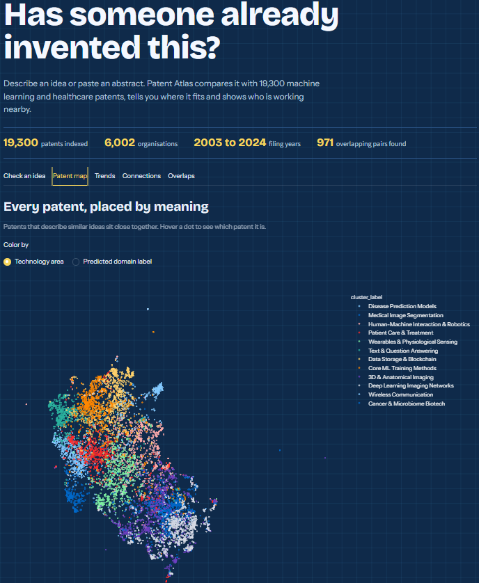
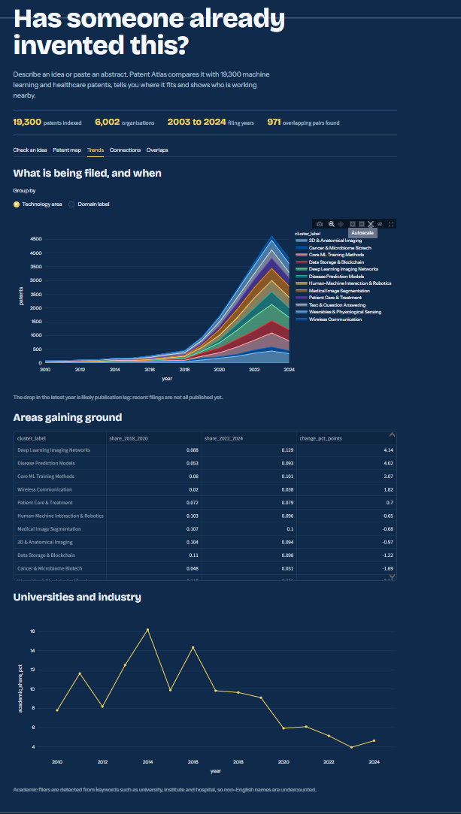
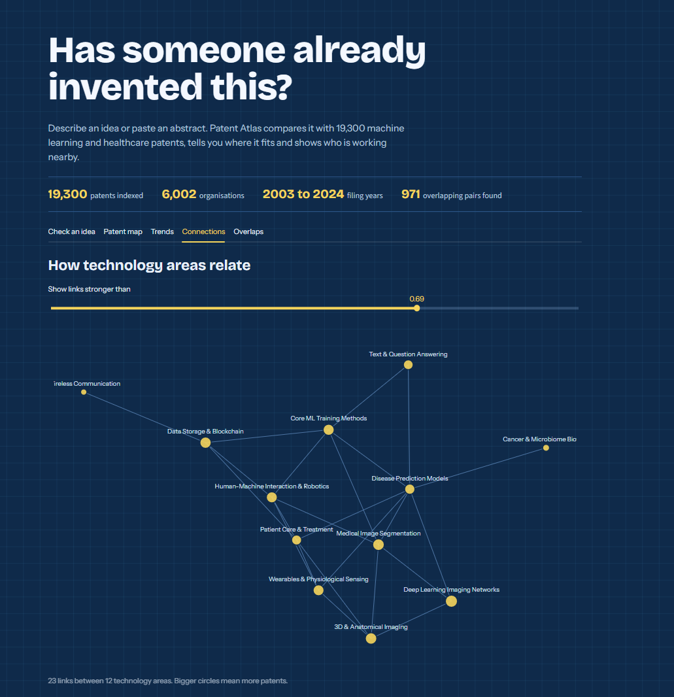
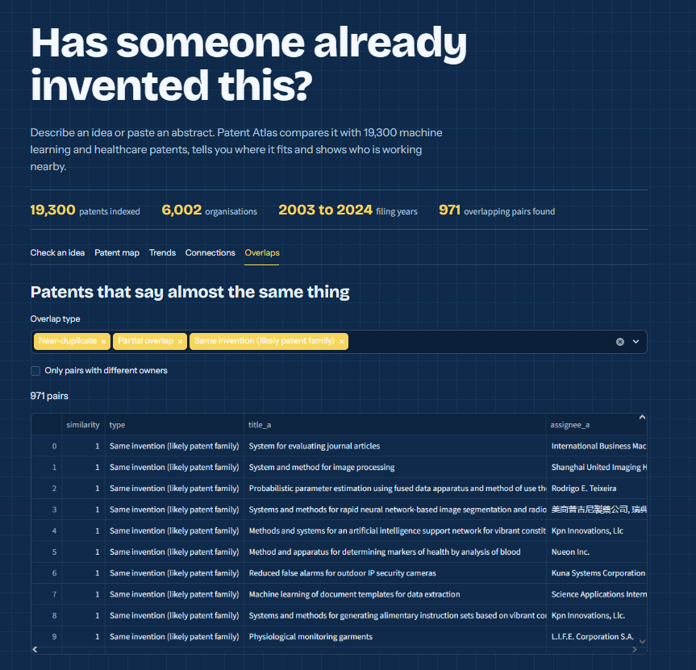
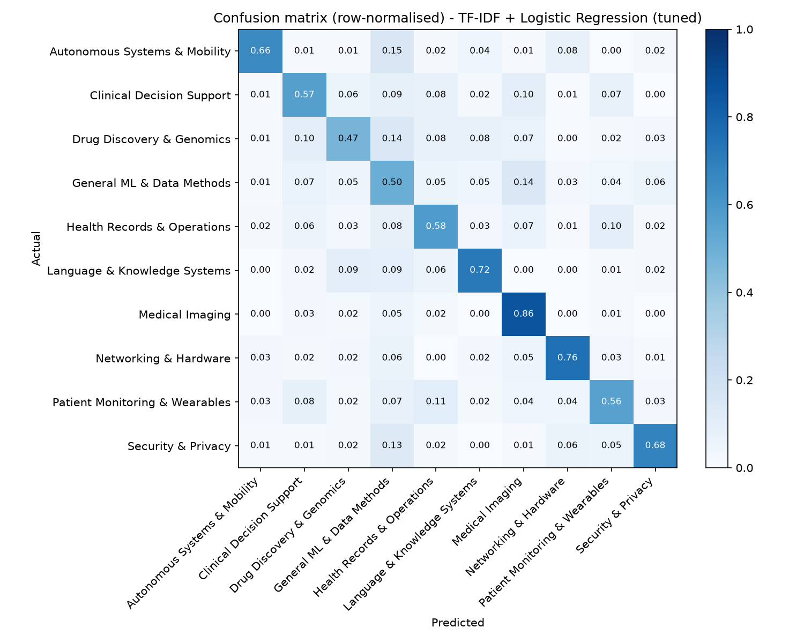
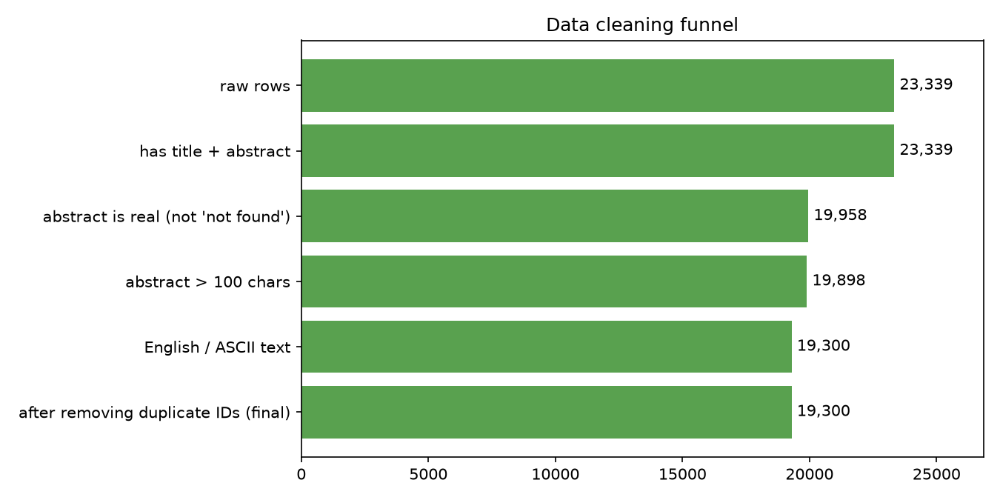
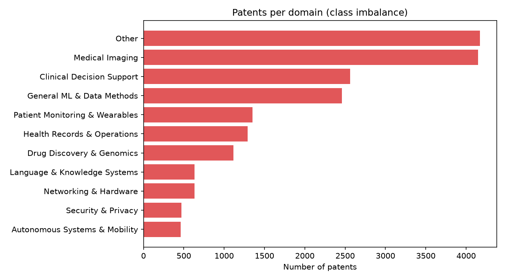
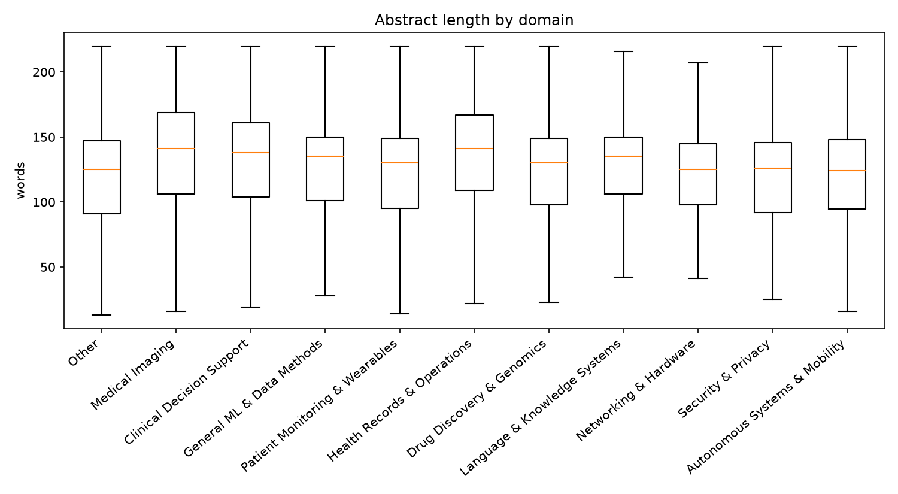
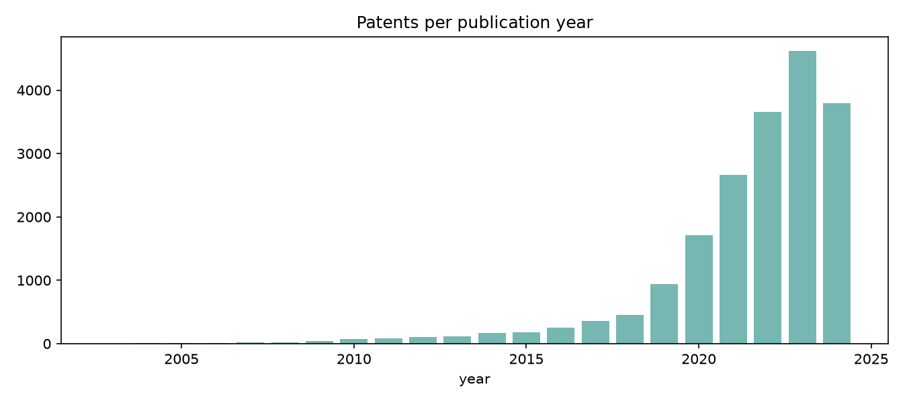

# University Patent & Innovation Intelligence Platform

Supervised Machine Learning course project (Project 18).

**Live demo:** https://university-patent-intelligence.streamlit.app

**Dataset Link:** https://www.kaggle.com/datasets/karnikakapoor/ml-in-healthcare-patent-data 

An end-to-end ML platform that turns unstructured patent text into searchable, analyzable knowledge: it classifies patents into technology domains, finds similar patents, clusters innovations, detects duplicate/overlapping filings, tracks trends and maps relationships between technology areas.

**Team:** [Name 1], [Name 2], [Name 3]

---

## Screenshots

| Search, classify and explain | Cluster map |
|---|---|
|  |  |

| Trends | Technology network |
|---|---|
|  |  |

| Overlap checker | Confusion matrix |
|---|---|
|  |  |

---

## Problem definition

- **Problem:** Researchers and innovation teams cannot easily see what already exists, where technologies overlap, or which areas are growing, because patents are long unstructured documents.
- **Users:** university innovation/tech-transfer offices, researchers, R&D teams.
- **ML objective:** classify a patent abstract into a technology domain (supervised), plus unsupervised similarity, clustering and duplicate detection.
- **Input:** patent text (abstract). **Output:** predicted domain, similar patents, cluster, overlap warning, word-level explanation.
- **Success criteria:** beat a majority-class baseline by a wide margin on macro-F1, evaluate without data leakage, explain predictions, and deploy a working app.

## Dataset

- **Source:** "Machine Learning and Healthcare Patent Dataset" by Karnika Kapoor on Kaggle (license CC0), curated from Google Patents.
- **Raw size:** ~23k patents (2.9 GB CSV with claims and descriptions). Fields: patent ID, title, assignee, priority/publication date, abstract, claims, description.
- **After cleaning:** 19,300 patents (2003-2024): English only, abstracts present and longer than 100 characters, duplicates by ID removed.
- **Not included in this repo:** the raw CSV (too large). Download it from Kaggle and place it at `data/raw/patent_analysis_data.csv`. The processed files needed by the app are included in `data/processed/`.

## Exploratory data analysis

Full script: `src/eda.py`. Figures: `reports/eda/`.

- **Missing values and cleaning:** only abstracts were missing (14.5% of 23,339 raw rows). After removing missing/short/non-English abstracts and duplicate IDs, 19,300 patents (82.7%) remain.
- **Class imbalance:** largest/smallest trainable domain ratio is 9.0x (Medical Imaging 4,149 vs Autonomous Systems 463). Handled with stratified splits, class weights and macro-F1.
- **Distributions and outliers:** abstracts average 129 words (median 133, max 532); only 0.7% exceed the IQR upper fence, so no outlier removal was applied.
- **Correlations:** numeric features are weakly correlated (|rho| <= 0.20) and the data is mostly text, so modelling relies on NLP features rather than numeric ones.
- **Assignees:** 6,002 distinct primary assignees; the top 15 hold 20% of patents (IBM 5.7%).
- **Trends:** patents per year peak in 2023 (4,615); the latest year is incomplete because of publication lag.
- **Text vs domain:** distinctive abstract words per domain are sensible (for example *segmentation, ultrasound* for imaging; *blockchain, encrypted* for security). Shared words such as *patient*, *data* and *user* appear across several domains, which explains many confusions.

| Cleaning funnel | Class balance |
|---|---|
|  |  |

| Abstract length by domain | Patents per year |
|---|---|
|  |  |

## Methodology

1. **Document processing:** keep title, assignee, dates and abstract; filter language and missing abstracts.
2. **Weak labelling:** the dataset has no domain labels, so each patent gets one of 10 technology domains (+ "Other") from title keywords (`src/label_patents.py`). The classifier is trained on the **abstract only**, so it must learn patterns from the text, not copy the title rule. "Other" is excluded from training (15,131 patents used).
3. **Leakage-safe split:** 811 patents are repeats of another patent (patent families). Duplicates are grouped (embedding similarity >= 0.90 or identical title) and split with `StratifiedGroupKFold`, so a family never appears in both train and test. 80% train / 20% held-out test; 3-fold grouped cross-validation on train acts as validation.
4. **Models compared:** majority-class baseline, Complement Naive Bayes, Logistic Regression, Linear SVM, Random Forest (bagging), TF-IDF + SVD + Gradient Boosting (boosting), and Logistic Regression on sentence embeddings. All text models are scikit-learn `Pipeline`s.
5. **Tuning:** `RandomizedSearchCV` over n-gram range, vocabulary size, min document frequency and regularization strength `C`.
6. **Selection:** by cross-validation macro-F1 on the training set only. The test set is used once for reporting.
7. **Similarity and search:** `all-MiniLM-L6-v2` Sentence Transformer embeddings + cosine similarity.
8. **Clustering:** KMeans (K=12) on embeddings, named by distinctive TF-IDF terms; UMAP for the 2D map.
9. **Duplicate/overlap detection:** cosine similarity >= 0.90, tiered into patent-family, near-duplicate and partial overlap; assignee names are cleaned so same-owner pairs can be separated from cross-owner overlaps.
10. **Trend analysis:** patents per year, emerging areas (change in share), academic vs industry share.
11. **Technology mapping:** NetworkX graph of cluster centroids linked by similarity.
12. **Explainability:** SHAP `LinearExplainer` on the TF-IDF + Logistic Regression model shows which words push a prediction toward or away from a domain.

## Results

Held-out test set (3,027 patents, no duplicate group shared with training):

| Model | CV macro-F1 | Test macro-F1 | Test accuracy |
|---|---|---|---|
| Baseline (majority class) | 0.043 | 0.043 | 0.274 |
| TF-IDF + Naive Bayes | 0.538 | 0.545 | 0.600 |
| TF-IDF + Random Forest | 0.558 | 0.573 | 0.624 |
| TF-IDF + SVD + Gradient Boosting | 0.534 | 0.555 | 0.602 |
| TF-IDF + Linear SVM | 0.596 | 0.600 | 0.641 |
| TF-IDF + Logistic Regression | 0.596 | 0.617 | 0.648 |
| Embeddings (abstract) + Logistic Regression | 0.599 | 0.598 | 0.637 |
| **TF-IDF + Logistic Regression (tuned), final model** | **0.605** | **0.616** | **0.649** |

Full table: `reports/model_comparison.csv`. Per-class report: `reports/classification_report.txt`. Misclassified examples: `reports/misclassified_examples.csv`.

### Key findings

- Every real model beats the majority-class baseline by a wide margin (macro-F1 ~0.60 vs 0.04).
- Linear models beat tree ensembles on sparse TF-IDF features; tuning improved macro-F1 only slightly (0.596 to 0.605). Five different model families land at similar scores, which points to **label quality, not the algorithm, as the ceiling**.
- **Label leakage caught and fixed:** embeddings built from title + abstract scored 0.670 macro-F1, but because labels come from title keywords this was inflated. Using abstract-only embeddings gives 0.599.
- **Duplicate leakage check:** a naive random split gave 0.613 vs 0.617 with the duplicate-safe split, so duplicates did not noticeably inflate results here.
- Best domain: Medical Imaging (F1 0.83). Weakest: Drug Discovery & Genomics (F1 0.49).
- Error analysis: confusions happen between overlapping domains (General ML vs Medical Imaging, Clinical Decision Support vs Imaging/Records). Many of the most confident "mistakes" are label noise (for example a "folding state hall sensor" patent labelled Patient Monitoring because of the word "sensor"; the model predicted Networking & Hardware, which fits better).
- Academic assignees' share of patents fell from about 10% (2017) to about 4.6% (2024), as measured by a keyword-based flag.

## Limitations

- Labels are weak (title keywords), so reported scores measure agreement with the rules, not expert judgement.
- The dataset is limited to machine learning and healthcare patents from one search query; results may not generalise to other fields.
- English-only (non-English patents were filtered out); the latest year is incomplete because of publication lag.
- The academic/industry flag is keyword-based and undercounts non-English institution names. Assignee name matching is approximate.
- KMeans with K=12 was chosen heuristically.
- Short text queries get low-confidence predictions; full abstracts work better.

## Repository structure

```
app/app.py                  Streamlit dashboard (deployed)
src/extract_patents.py      read raw CSV in chunks, filter, clean
src/label_patents.py        weak labelling by title keywords
src/embed.py                title+abstract embeddings (search, clustering, duplicates)
src/embed_abstract.py       abstract-only embeddings (classification, avoids label leakage)
src/cluster.py              KMeans + UMAP + cluster naming
src/entities.py             assignee cleaning, academic flag
src/duplicates.py           duplicate / overlap detection
src/classify.py             early baseline classifier (superseded by experiment.py)
src/experiment.py           full model comparison, tuning, error analysis, final pipeline
reports/                    comparison table, classification report, confusion matrix, errors
data/processed/             files needed by the app
requirements.txt            slim dependencies for deployment
requirements-full.txt       full environment used for development
```

## Run it locally

Python 3.12 is recommended.

```bash
pip install -r requirements-full.txt
```

To reproduce everything from the raw data, download the dataset to `data/raw/patent_analysis_data.csv`, then run in order:

```bash
python src/extract_patents.py
python src/label_patents.py
python src/embed.py
python src/cluster.py
python src/entities.py
python src/duplicates.py
python src/embed_abstract.py
python src/experiment.py
```

To just run the app (the processed files are already in the repo):

```bash
streamlit run app/app.py
```

## Deployment

Deployed on Streamlit Community Cloud (Python 3.12, CPU-only PyTorch) from the `main` branch with `app/app.py` as the entry point. Every push to `main` redeploys the app.

## Module coverage

| Brief module | Where |
|---|---|
| Patent data collection | Kaggle/Google Patents dataset, `src/extract_patents.py` |
| Document processing | `src/extract_patents.py`, TF-IDF pipeline |
| Entity extraction | `src/entities.py` (assignee cleaning, academic vs industry) |
| Technology classification | `src/experiment.py` |
| Semantic similarity | `src/embed.py`, Search tab |
| Innovation clustering | `src/cluster.py`, Cluster Map tab |
| Trend analysis | Trends tab |
| Duplicate / overlap detection | `src/duplicates.py`, Overlap Checker tab |
| Technology mapping | Technology Network tab (NetworkX) |
| Visualization | Plotly charts across the app |
| Search & recommendation | Search & Classify tab |
| Explainability (SHAP) | Search & Classify tab |
| Deployment | Streamlit Community Cloud |

## Acknowledgements

- Dataset: Karnika Kapoor, "Machine Learning and Healthcare Patent Dataset", Kaggle (CC0), derived from Google Patents.
- Libraries: pandas, NumPy, scikit-learn, sentence-transformers (`all-MiniLM-L6-v2`), SHAP, UMAP, NetworkX, Plotly, Streamlit, PyTorch.
- An AI coding assistant was used during development, and the team reviewed and is responsible for all code. [Adjust this line to match your university's policy.]
